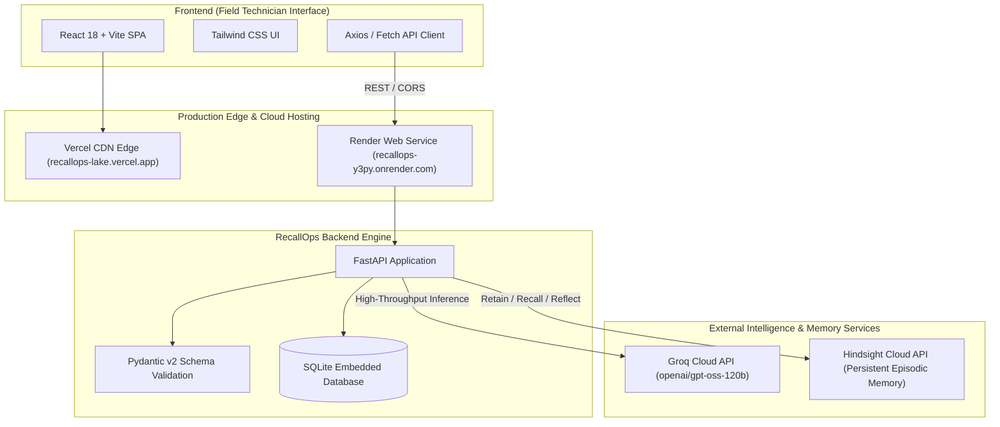

# RecallOps — The Self-Learning Industrial Maintenance Agent

> Autonomous industrial diagnostic intelligence with closed-loop episodic memory and verified field repair learning.

[](https://recallops-lake.vercel.app)
[](https://recallops-y3py.onrender.com/health)
[](LICENSE)

---

## 🏭 1. The Industrial Maintenance Problem

In modern heavy manufacturing, mining, refining, and power generation facilities, unplanned equipment downtime is catastrophic—often costing between **\$260,000 and \$500,000 per hour** in lost production and secondary mechanical destruction.

Industrial operations face four chronic structural bottlenecks:

1. **The "Tribal Knowledge" Cliff**: Decades of nuanced mechanical intuition reside solely in the minds of veteran maintenance engineers. When senior technicians retire or shift rotations hand off, critical troubleshooting history is permanently lost.
2. **LLM Stateless Amnesia**: Commercial large language models operate on static pre-training weights. They cannot remember what failed on Tuesday when diagnosing a similar symptom on Friday without costly, slow retraining cycles.
3. **Repeated Diagnostic Blunders**: When an initial diagnostic hypothesis fails (e.g., repeatedly replacing motor bearings when the actual root cause was shaft coupling misalignment), standard diagnostic systems naively recommend the exact same failed action on subsequent incidents.
4. **Hallucination Risk in Hazardous Environments**: Generic AI tools generate ungrounded advice. In industrial settings, incorrect guidance on high-pressure slurry lines or 4160V motors creates severe personnel safety risks.

---

## 💡 2. Our Proposed Solution: RecallOps

**RecallOps** is an autonomous industrial maintenance intelligence platform that bridges real-time telemetry reasoning with permanent episodic memory.

Instead of treating diagnostic models as static calculators, RecallOps incorporates **closed-loop technician verification**:

- When an incident occurs, RecallOps cross-references active symptoms against past historical episodes stored in **Hindsight Cloud**.
- It reasons over equipment history and current telemetry using **Groq** (`openai/gpt-oss-120b`) to formulate an evidence-backed hypothesis and non-destructive inspection protocol.
- **Crucially, it differentiates between what succeeded and what failed in the past**, explicitly warning field technicians against repeating prior unsuccessful actions.
- Following physical repairs, a certified technician signs off on the actual outcome. Only **verified, certified outcomes** are committed to permanent episodic memory, ensuring the system continually learns without hallucinating or corrupting its knowledge base.

---

## ✨ 3. Main Features

- **Fleet Health & Real-Time Incident Reporting**: Continuous monitoring across industrial machines (centrifugal slurry pumps, reciprocating compressors, cooling towers, hydraulic presses). Quickly log thermal anomalies, vibration peaks, and acoustic anomalies.
- **Evidence-Grounded AI Investigation**: Structured Pydantic diagnostic contracts guaranteeing root cause hypotheses, calibrated confidence scores, step-by-step non-destructive inspection protocols, and critical safety warnings (LOTO, thermal PPE, line pressure bleed).
- **Hindsight Long-Term Episodic Memory**: Semantic vector recall and historical reflection over past maintenance episodes across the entire plant fleet.
- **Positive vs. Negative Precedent Differentiation**: Distinctly categorizes prior cases:
  - *Verified Precedents*: Proven repairs that resolved identical failure modes.
  - *Unsuccessful Attempts*: Failed interventions to avoid repeating.
- **Closed-Loop Technician Verification**: Strict governance workflow requiring technician credentialing and certification checkboxes before any resolution is promoted to reusable plant memory.
- **Controlled Learning Benchmark**: Side-by-side empirical evaluation testing diagnostic precision before and after episodic memory retention.
- **Fleet Dashboard & Filtering**: High-contrast, responsive operational UI designed for ruggedized field tablets, mobile devices, and control room monitors.

---

## 🧠 4. Hindsight-Powered Long-Term Memory

RecallOps utilizes **Hindsight Cloud** as its continuous episodic memory layer. Unlike simple vector databases or static RAG caches, Hindsight provides high-level cognitive memory primitives:

```
┌────────────────────────────────────────────────────────────────────────┐
│                        HINDSIGHT CLOUD ARCHITECTURE                    │
│                                                                        │
│   [ Technician Sign-Off ]                                              │
│              │                                                         │
│              ▼                                                         │
│      ┌───────────────┐        Episodic Bank: 'recallops-demo'         │
│      │ retain()      │ ────►  Permanent storage of verified outcomes   │
│      └───────────────┘        with machine context and symptom tags    │
│                                                                        │
│   [ New Incident Query ]                                               │
│              │                                                         │
│              ▼                                                         │
│      ┌───────────────┐        Vector + Semantic Contextual Retrieval   │
│      │ recall()      │ ◄────  Extracts relevant historical precedents  │
│      └───────────────┘        and flags previous failed repairs        │
│              │                                                         │
│              ▼                                                         │
│      ┌───────────────┐        Multi-Incident Synthesis                 │
│      │ reflect()     │ ────►  Identifies cross-machine failure         │
│      └───────────────┘        patterns across the equipment fleet      │
└────────────────────────────────────────────────────────────────────────┘
```

### Governance & Memory Integrity
- **Idempotency Protection**: Re-submitting verification for an already closed incident returns the existing record without duplicating memory embeddings.
- **Conflict Prevention**: Conflicting verification attempts on closed incidents are rejected (`HTTP 409 Conflict`), maintaining strict audit trails.
- **Bank Isolation**: Production operational memory (`recallops-demo`) is physically separated from benchmark evaluation banks (`recallops-exp-baseline` and `recallops-exp-learned`).

---

## 🏗️ 5. System Architecture & Technology Stack



### Technology Stack Summary

| Layer | Component | Specification |
|---|---|---|
| **Frontend Framework** | React 18 | Vite v5, Lucide React icons |
| **Styling** | Tailwind CSS v3 | High-contrast dark industrial palette |
| **Backend Framework** | FastAPI | Python 3.10+, Uvicorn ASGI server |
| **Data Validation** | Pydantic v2 | Strict JSON schema contracts |
| **Reasoning Engine** | Groq API | Model: `openai/gpt-oss-120b` |
| **Long-Term Memory** | Hindsight Cloud | Dedicated episodic memory banks |
| **Persistence** | SQLite | Local relational storage for machines and incidents |
| **Hosting & CI/CD** | Vercel + Render | Automated Git deployments with zero downtime |

---

## 🔄 6. The Investigation & Verified-Learning Workflow

```
[ Step 1: Incident Creation ]
Technician logs machine ID, severity level, operating telemetry, and observed symptoms.
              │
              ▼
[ Step 2: AI Investigation & Precedent Recall ]
Backend queries Hindsight Cloud for matching failure profiles.
Groq synthesizes symptoms with retrieved precedents into a structured protocol:
- Root cause hypothesis
- Calibrated confidence rating
- Sequential non-destructive inspection steps
- Mandatory safety warnings
- Successful precedents vs. previous failed repairs
              │
              ▼
[ Step 3: Physical Field Repair ]
Technician carries out inspection, isolates machine (LOTO), and logs the physical repair.
              │
              ▼
[ Step 4: Certified Outcome Verification ]
Technician performs post-repair test run, records vibration/temperature delta,
checks the certification box, and marks the incident as Resolved or Unsuccessful.
              │
              ▼
[ Step 5: Hindsight Episodic Retention ]
Verified repair episode is permanently retained in Hindsight Cloud.
              │
              ▼
[ Step 6: Fleet-Wide Knowledge Transfer ]
Subsequent incidents on identical or similar machines immediately recall this verified experience.
```

---

## 🧪 7. Controlled Learning Benchmark

To verify whether episodic memory retention genuinely improves diagnostic accuracy without parameter fine-tuning, RecallOps includes a controlled synthetic evaluation suite:

```text
========================================================================================
CONDITION A: Zero-Context Baseline (Without M-112 Episodic Memory)
- Symptoms: Centrifugal Slurry Pump high-frequency vibration and casing temperature spike
- Precedent Available: Baseline M-104 (ventilation) and M-108 (bearing re-grease failure)
- Diagnostic Result: 0 / 3 trials identified coupling misalignment and dynamic balancing.
========================================================================================
CONDITION B: With Verified Episodic Memory (M-112 Retained in Hindsight)
- Symptoms: Identical symptoms, identical machine parameters, identical prompts
- Precedent Available: Verified outcome from M-112 (mechanical seal flush & shaft alignment)
- Diagnostic Result: 3 / 3 trials successfully prioritized coupling alignment and balance.
========================================================================================
```

> [!NOTE]
> **Controlled Synthetic Trial Disclaimer**: This benchmark evaluates deterministic recall and prompt conditioning across controlled synthetic trials. It demonstrates the architectural efficacy of episodic memory integration and does not represent unconstrained real-world industrial plant certification.

---

## 🌐 8. Live Deployments

- **Production Frontend**: [https://recallops-lake.vercel.app](https://recallops-lake.vercel.app)
- **Production Backend API**: [https://recallops-y3py.onrender.com](https://recallops-y3py.onrender.com)
- **Interactive Swagger Docs**: [https://recallops-y3py.onrender.com/docs](https://recallops-y3py.onrender.com/docs)
- **API Health Endpoint**: [https://recallops-y3py.onrender.com/health](https://recallops-y3py.onrender.com/health)
- **Source Code Repository**: [https://github.com/Rahul-2006ra/recallops](https://github.com/Rahul-2006ra/recallops)

---

## 💻 9. Local Installation & Setup

### Prerequisites
- **Python**: Version 3.10, 3.11, or 3.12
- **Node.js**: Version 18.x or 20.x
- **npm**: Version 9.x or higher

### Step 1: Clone Repository
```bash
git clone https://github.com/Rahul-2006ra/recallops.git
cd recallops
```

### Step 2: Environment Configuration
Copy `.env.example` to `.env` in the root directory:
```bash
cp .env.example .env
```

Configure your `.env` file using your API keys:
```ini
# Application Configuration
APP_ENV=development
HOST=0.0.0.0
PORT=8000
CORS_ORIGINS=http://localhost:5173,http://127.0.0.1:5173

# Groq Cloud API
GROQ_API_KEY=your_groq_api_key_here
GROQ_MODEL=openai/gpt-oss-120b

# Hindsight Cloud Memory
HINDSIGHT_API_KEY=your_hindsight_api_key_here
HINDSIGHT_BASE_URL=https://api.hindsight.vectorize.io
HINDSIGHT_BANK_ID=recallops-demo

# SQLite Database
DATABASE_URL=sqlite:///./recallops.db
```

### Step 3: Backend Setup
```bash
# Create and activate virtual environment
python -m venv .venv

# Windows (PowerShell)
.\.venv\Scripts\Activate.ps1

# Linux / macOS
source .venv/bin/activate

# Install dependencies
pip install -r requirements.txt

# Start backend server
uvicorn backend.main:app --reload --port 8000
```
Backend will be live at `http://localhost:8000`.

### Step 4: Frontend Setup
```bash
# Open a new terminal and navigate to frontend
cd frontend

# Install dependencies
npm install

# Start Vite development server
npm run dev
```
Frontend will be live at `http://localhost:5173`.

---

## 🧪 10. Automated Testing & Verification

The project includes an end-to-end test suite covering frontend browser workflows, API contracts, and memory isolation:

```bash
# Run backend pytest suite (20 tests)
pytest -v

# Run frontend production build
cd frontend
npm run build

# Run Playwright real-browser automation suite
node qa_evidence/browser_e2e_test.js

# Run API security and reliability audit
python qa_evidence/api_security_reliability_test.py
```

### Automated QA Test Results Summary

| Suite | Scope | Result |
|---|---|:---:|
| **Playwright Real-Browser E2E** | All 6 views, modal forms, live AI investigation, repair and verification workflow, responsive viewports | **20 / 20 PASSED** |
| **API Security & Reliability** | CORS validation, malicious origin rejection, schema enforcement, concurrency, idempotency | **17 / 17 PASSED** |
| **Backend Pytest Regression** | Health check, Hindsight retain/recall/reflect, Groq structured output, bank isolation | **20 / 20 PASSED** |
| **Static Security Audit** | Secret leakage scanning, `.env` file inspection, XSS vulnerability check | **3 / 3 PASSED** |
| **Total Automated Tests** | Comprehensive 360° verification | **60 / 60 PASSED** |

---

## ⚠️ 11. Limitations & Future Roadmap

### Current Limitations
- **Render Free-Tier Spin-Down**: The free-tier container spins down after 15 minutes of inactivity, resulting in a ~45-second cold start on initial wake-up.
- **Ephemeral SQLite Disk**: Incident tickets stored in local SQLite reset upon container redeployment. *Note: Verified repair episodes in Hindsight Cloud are persistent and survive container restarts.*
- **Synthetic Sensor Ingestion**: Incidents currently rely on technician-reported telemetry rather than direct PLC streaming.

### Future Roadmap
1. **Direct Industrial Protocol Ingestion**: Native connectors for OPC-UA, MQTT, and Modbus TCP to stream real-time SCADA sensor packets directly into the investigation engine.
2. **Multi-Modal Diagnostic Evidence**: Direct image upload for infrared thermography, acoustic spectrograms, and borescope inspection photographs.
3. **Offline-First Progressive Web App (PWA)**: Local SQLite/IndexedDB synchronization allowing technicians in remote subterranean facilities to log repairs offline and sync to Hindsight Cloud upon returning to network coverage.

---

## 👥 12. Team Credits

RecallOps was engineered and developed by:

- **Rahul R**
- **Vasundhara S**

---

## 📄 13. License

This project is licensed under the MIT License — see the [LICENSE](LICENSE) file for details.
